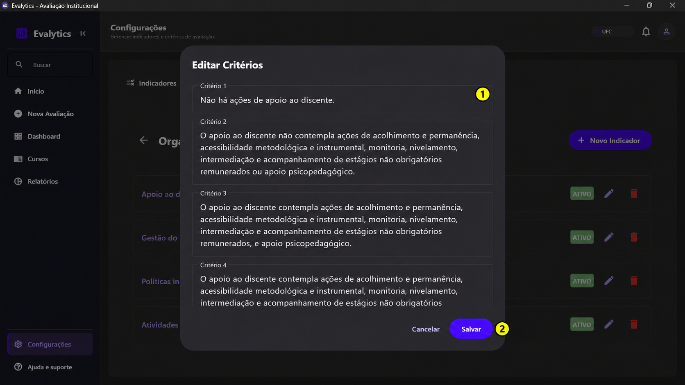
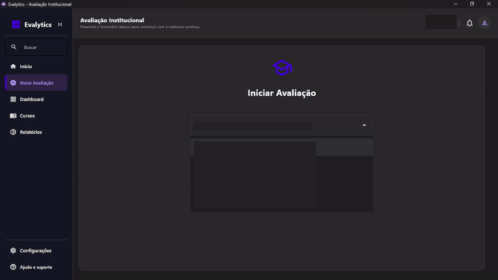
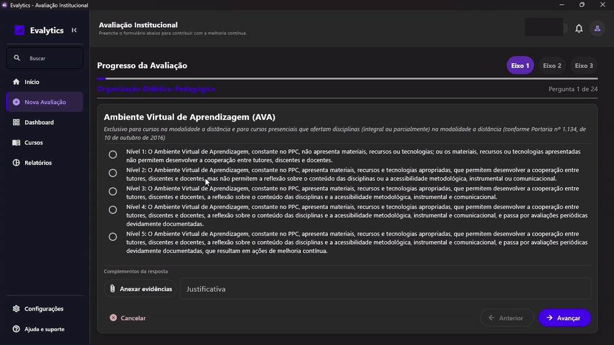
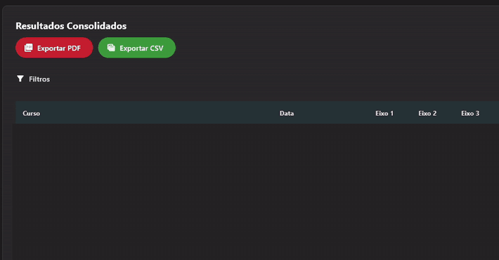

# Guia de uso do Evalytics

Para consultar a estrutura do projeto e os fluxos de armazenamento das avaliações, acesse o [Mapa técnico](mapa-tecnico.md).

Após a autenticação, utilize o menu lateral para acessar o cadastro de cursos e indicadores, o formulário de avaliação e a exportação de resultados. Se o curso e os indicadores já estiverem cadastrados e ativos, acesse **Nova Avaliação**.

## Sumário

- [Cadastro de cursos](#1-cadastro-de-cursos)
- [Configuração de indicadores](#2-configuração-de-indicadores)
- [Preenchimento e envio da avaliação](#3-preenchimento-e-envio-da-avaliação)
  - [Exemplo de autoavaliação](#exemplo-de-autoavaliação)
  - [Seleção de evidências e redação de justificativas](#seleção-de-evidências-e-redação-de-justificativas)
  - [Lista de verificação antes do envio](#lista-de-verificação-antes-do-envio)
- [Consulta e exportação de resultados](#4-consulta-e-exportação-de-resultados)
  - [Interpretação dos resultados](#interpretação-dos-resultados)
  - [Exemplos de exportação](#exemplos-de-exportação)
- [Após o envio da avaliação](#5-após-o-envio-da-avaliação)
- [Solução de problemas](#solução-de-problemas)

## 1. Cadastro de cursos

1. Abra **Cursos** e selecione **Adicionar curso**.
2. Informe o nome e o departamento. O campo de coordenador é opcional. A aplicação gera o código do curso automaticamente.
3. Mantenha o status **Ativo** para disponibilizar o curso em **Nova Avaliação**. Clique em **Salvar**.

## 2. Configuração de indicadores

1. Em **Configurações**, selecione a aba **Indicadores** e abra a pasta do eixo avaliativo.
2. Clique em **Novo Indicador**, informe o título e, se necessário, a descrição. Clique em **Salvar**.
3. Clique no título do indicador para abrir **Editar Critérios**. Defina o critério correspondente a cada nota e clique em **Salvar**. O formulário de avaliação apresenta os indicadores ativos.

  

1. **Campos de critério.** Preencha a descrição correspondente a cada nota. Role a janela para acessar os campos restantes.
2. **Salvar.** Selecione o botão para registrar as alterações.

### Manutenção do catálogo

- Para atualizar o título ou a descrição, selecione **Editar** na linha do indicador e clique em **Salvar** após a revisão.
- Para revisar os critérios de pontuação, clique no título do indicador, altere os critérios em **Editar Critérios** e clique em **Salvar**.
- Para retirar um indicador das próximas avaliações, clique no status **ATIVO** na linha do indicador e verifique se ele passou a **INATIVO**. Para reativá-lo, clique em **INATIVO**.
- Para consultar os critérios utilizados em uma avaliação anterior, exporte o PDF em **Relatórios** e consulte a seção detalhada da avaliação. Quando o registro contém uma cópia das perguntas, o PDF apresenta os critérios da época. Para registros sem essa cópia, o PDF consulta o catálogo atual e identifica a origem das perguntas. No CSV, consulte a coluna `Fonte_Perguntas`.

## 3. Preenchimento e envio da avaliação

1. Abra **Nova Avaliação**, selecione o curso e clique em **Abrir avaliação**.
2. Selecione a nota de cada indicador e registre a justificativa no campo correspondente. Para incluir documentos comprobatórios, selecione **Anexar evidências** no indicador.
3. Clique em **Avançar** para acessar o próximo indicador. Para acessar a primeira pergunta de outro eixo, selecione o eixo correspondente.
4. Na última pergunta, clique em **Finalizar** e aguarde a confirmação **Avaliação Enviada!**.

O formulário aceita até 20 arquivos por indicador, com até 10 MB cada. Entre os formatos aceitos estão PDF, PNG, JPG, DOCX, XLSX e CSV.

### Abertura da avaliação

  

### Preenchimento & Envio da avaliação

  

### Exemplo de autoavaliação

Este exemplo utiliza um curso fictício de Pedagogia e o indicador **Planos de ensino**, do eixo **Organização Didático-Pedagógica**.

1. Em **Nova Avaliação**, selecione o curso de Pedagogia e clique em **Abrir avaliação**.
2. No indicador **Planos de ensino**, considere um critério de nota 4 que exige planos revisados e disponíveis para consulta. Se a documentação comprovar essas duas condições, selecione a nota 4.
3. Registre a justificativa no campo correspondente. Exemplo de redação: “Os planos de ensino das disciplinas do semestre foram revisados pela coordenação e disponibilizados para consulta. O anexo identifica as disciplinas e as datas de revisão.”
4. Selecione **Anexar evidências** e inclua o arquivo `planos-de-ensino.pdf`. Prossiga com os demais indicadores, conclua a lista de verificação e selecione **Finalizar** na última pergunta.
5. Após a confirmação **Avaliação Enviada!**, abra **Relatórios** e filtre pelo curso de Pedagogia e pelo semestre da avaliação. Exporte o PDF com esses mesmos filtros para consultar a nota, a justificativa e a referência da evidência.

### Seleção de evidências e redação de justificativas

1. **Identifique o que o critério exige.** No exemplo de Pedagogia, a nota 4 exige que os planos de ensino tenham sido revisados e estejam disponíveis para consulta.
2. **Selecione documentos que comprovem os requisitos.** Para comprovar a revisão, anexe um registro que identifique as disciplinas e as datas de revisão. Para demonstrar a disponibilidade, inclua um registro da publicação dos planos com a data e o local de consulta. Se um único documento comprovar ambos os requisitos, indique onde cada informação pode ser encontrada.
3. **Relacione a nota às evidências na justificativa.** Registre o que foi verificado, o período a que se refere e onde a informação consta no anexo. Use o nome do arquivo e, quando possível, a página ou a seção.

> No semestre 2026.2, a coordenação revisou os planos de ensino das disciplinas avaliadas. O arquivo `planos-de-ensino.pdf` apresenta as disciplinas e as datas de revisão na página 2. A página 3 registra a disponibilização dos planos no ambiente acadêmico. Esses registros sustentam a nota 4.

Se os documentos comprovarem apenas parte do critério, registre a lacuna na justificativa e atribua a nota correspondente ao que foi comprovado.

### Lista de verificação antes do envio

- [ ] O curso selecionado corresponde ao curso avaliado.
- [ ] As notas correspondem aos critérios dos respectivos indicadores.
- [ ] As justificativas registram os fatos que fundamentam as notas.
- [ ] Os arquivos selecionados estão associados aos indicadores correspondentes e podem ser abertos.

## 4. Consulta e exportação de resultados

1. Abra **Relatórios**. Na tela **Dados e Exportação**, selecione o semestre, o curso ou o eixo avaliativo em **Filtros** e clique em **Aplicar filtros**.
2. Clique em **Exportar CSV** para gerar um arquivo de dados ou em **Exportar PDF** para gerar o relatório.
3. Na janela de exportação, selecione o curso, o semestre e o eixo desejados. Selecione **Todos** para incluir todos os valores de um campo. Confirme com **Exportar CSV** ou **Gerar PDF**, conforme o formato selecionado.
4. Na janela de salvamento, informe o nome do arquivo e selecione a pasta de destino.

### Exportação em CSV

  

### Interpretação dos resultados

- **Filtros.** O semestre é determinado pela data da avaliação. O filtro de curso restringe a consulta ao curso selecionado. O filtro de eixo mantém na tabela as avaliações com respostas numéricas naquele eixo. A janela de exportação aplica seus próprios filtros.
- **Médias na tabela.** Para cada avaliação, a média de um eixo é a soma das notas numéricas associadas ao eixo dividida pela quantidade dessas notas. A média geral atribui o mesmo peso a cada eixo respondido. O cálculo associa os indicadores aos eixos do catálogo atual.
- **PDF.** Apresenta um resumo e o detalhamento das avaliações selecionadas, com notas, critérios, justificativas e referências das evidências quando disponíveis. A média de cada eixo no resumo é calculada a partir das médias positivas daquele eixo nas avaliações selecionadas. Ao filtrar por eixo, o detalhamento apresenta as perguntas do eixo selecionado e o resumo pode apresentar outros eixos dessas mesmas avaliações.
- **CSV.** Apresenta os dados por avaliação e indicador, incluindo nota, resposta selecionada, justificativa, evidências e origem das perguntas. O filtro de eixo determina quais avaliações são incluídas. O arquivo pode conter linhas de outros eixos dessas avaliações.

### Exemplos de exportação

Os dois arquivos apresentam a mesma avaliação fictícia de Pedagogia, com nota 4 no indicador **Planos de ensino**.

- [Relatório ilustrativo em PDF](exemplos/relatorio-exemplo.pdf) com o resumo por eixo, os critérios registrados, a justificativa e a referência da evidência.
- [Dados de exemplo em CSV](exemplos/dados-brutos-exemplo.csv) com as colunas da exportação e uma linha para o indicador avaliado. Ao importar o arquivo, selecione UTF-8 e ponto e vírgula como separador.

O endereço da evidência é ilustrativo.

## 5. Após o envio da avaliação

### Localização do registro

1. Após a confirmação **Avaliação Enviada!**, abra **Relatórios**, selecione o curso e o semestre em **Filtros** e clique em **Aplicar filtros**. Use a coluna **Data** para localizar a avaliação.
2. Se houver várias avaliações do mesmo curso na mesma data, exporte o CSV com os mesmos filtros. Use `Data_Avaliacao` para conferir a data e o horário registrados e `ID_Avaliacao` para distinguir os registros. As linhas com o mesmo identificador pertencem à mesma avaliação. O PDF apresenta esse identificador na seção detalhada.

### Solicitação de correção

Após o envio, o aplicativo não oferece edição de notas, justificativas ou evidências da avaliação. Se for necessário corrigir um registro, informe à equipe responsável o identificador da avaliação, o indicador afetado e a correção necessária. Aguarde a orientação da equipe antes de iniciar uma nova avaliação, pois um novo envio cria um registro adicional.

### Efeitos da inativação no histórico

- **Curso inativado.** O curso deixa de aparecer em **Nova Avaliação**. As avaliações anteriores permanecem disponíveis nos relatórios enquanto o curso estiver cadastrado. Se o cadastro for excluído, as avaliações associadas a ele deixam de aparecer nos relatórios.
- **Indicador inativado.** O indicador deixa de aparecer nos novos formulários. Os registros com cópia histórica preservam as perguntas, os critérios e as respostas da época. Nos registros sem essa cópia, o detalhamento consulta o catálogo atual, e os critérios do indicador inativado podem deixar de aparecer.

## Solução de problemas

- **Curso indisponível em Nova Avaliação.** Em **Cursos**, verifique se o curso está cadastrado e com status **Ativo**. Em seguida, acesse **Nova Avaliação** novamente.
- **Indicador ausente no formulário.** Em **Configurações**, acesse **Indicadores** e abra a pasta do eixo correspondente. Verifique se o indicador está cadastrado e ativo.
- **Arquivo de evidência recusado.** Verifique se o arquivo pode ser aberto localmente, se o formato é aceito e se o tamanho está dentro do limite de 10 MB. Cada indicador admite até 20 arquivos. Verifique também se o arquivo já consta na lista de anexos.
- **Falha no envio da avaliação.** Se a aplicação apresentar um erro ao clicar em **Finalizar**, verifique a conexão e repita o envio no mesmo formulário. Aguarde a confirmação **Avaliação Enviada!**.
- **Resultados diferentes dos esperados no relatório.** Verifique os filtros de curso, semestre e eixo. Selecione **Limpar** para restaurar a consulta sem filtros. Antes de confirmar a exportação, verifique também os filtros da janela de exportação.
